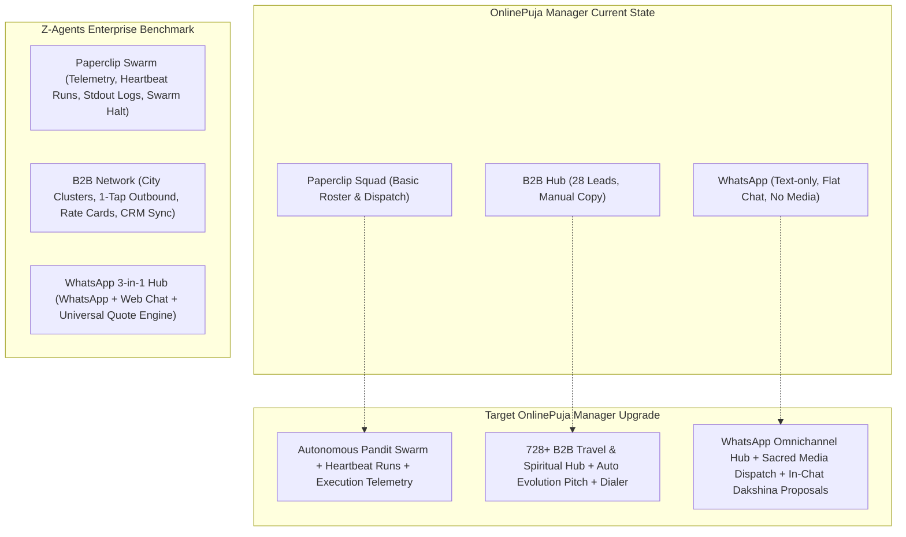

# 🔍 Deep Architectural Audit: Paperclip Swarm, B2B Wholesale Hub & WhatsApp Omnichannel
**OnlinePuja Manager vs Z-Agents Enterprise Comparison & Implementation Blueprint**
*Date: November 7, 2026*

---

## 1. Executive Summary

OnlinePuja Manager was audited against the enterprise benchmark of **Z-Agents** (`https://vmstudio.digital/z-agents/`, source: `D:\Dev\Z-Agents`). 

While OnlinePuja Manager possesses strong domain-specific Vedic foundations (Vedic Radar, Panchang countdown, Gotra Vault), its core operational engines—**Paperclip Multi-Agent Swarm**, **B2B Wholesale Hub**, and **WhatsApp Integration**—remain basic compared to Z-Agents' modular, production-tested implementations.

---

## 2. Paperclip Autonomous Agents Swarm Audit

### 2.1 Current Implementation in OnlinePuja Manager
- **File**: `lib/ui/screens/agents/paperclip_squad_screen.dart`
- **Model & Provider**: `paperclip_model.dart`, `paperclip_provider.dart`
- **Backend API**: `GET /api/manager/paperclip/overview` (Live on `OnlinePuja.live` with 8 agents, prefix `ONL`).
- **Current Strengths**:
  - Connects to live Paperclip instance `fcb854e2-4cff-4d8f-a0e3-587e5f1cfc8d`.
  - Displays Chief of Staff (`a7061c7c...`) and sub-agents.
  - Can dispatch missions via `POST /api/manager/paperclip/dispatch`.

### 2.2 Critical Gaps vs Z-Agents
| Feature | Z-Agents Benchmark | OnlinePuja Manager Current | Impact / Gap |
| :--- | :--- | :--- | :--- |
| **Execution Heartbeat Runs** | Live timeline of agent runs with duration, token spend, and completion status | ❌ Missing | Manager cannot see if an autonomous agent ran or failed silently. |
| **Terminal Stdout Logs** | Raw streaming output viewer (`fetchPaperclipRunLog(runId)`) | ❌ Missing | Cannot debug why an agent produced an error or review its work. |
| **Swarm Emergency Halt** | Global 1-tap kill-switch to freeze all autonomous sub-agents immediately | ❌ Missing | High risk of runaway token consumption or unapproved client emails. |
| **Agent Pause / Resume** | Per-agent granular pause with reason logging | ⚠️ Partially wired | UI lacks clear confirmation modal and reason prompt. |
| **Budget & Spend Telemetry** | Displays monthly dollar budget vs actual spent per agent | ❌ Missing | No financial guardrails visible in app. |

---

## 3. B2B Wholesale Hub Audit

### 3.1 Current Implementation in OnlinePuja Manager
- **File**: `lib/ui/screens/b2b/b2b_partner_hub_screen.dart`
- **Backend API**: `GET /api/manager/b2b/leads` (28 leads across Varanasi, Mumbai, Surat, Delhi, Jaipur, Bengaluru, etc.).
- **Current Strengths**:
  - Real database records with partner codes (`B2B-VIP-8433`, etc.), categories, and commission percentages (25%).
  - Dedicated admin test partner (`8433284743`).

### 3.2 Critical Gaps vs Z-Agents (`b2b_partners_view.dart`)
| Feature | Z-Agents Benchmark | OnlinePuja Manager Current | Solution |
| :--- | :--- | :--- | :--- |
| **1-Tap Direct WhatsApp Pitch** | Sends pre-templated commercial pitch directly via Evolution API with delivery tracking | ❌ Copy-to-clipboard only | Add 1-tap `Dispatch WhatsApp Pitch` directly from partner card. |
| **Smart Telephony Integration** | 1-tap call button launching dialer with partner business name & category attached | ❌ Missing | Connect to `CallProvider.startCall(...)`. |
| **Category Segmentation** | Multi-category tabs (`Travel Agencies`, `Hotels`, `Corporate Gifting`, `Samagri Stores`, `Event Planners`) | ❌ Single city filter only | Add Category filter strip with live counts. |
| **728 Travel Agencies Sync** | Seamless ingestion from TripCosmos DB (`tripcosmos.wp_tc_agent_agencies`) | ❌ Only 28 leads | Hook synchronization script to import verified agencies into B2B table. |
| **Universal Proposal / Rate Card** | In-app dialog to generate formal B2B wholesale package (PDF/HTML link) | ❌ Raw text only | Add Dev Deepawali & Shravan B2B rate card generator. |

---

## 4. WhatsApp Integration Audit: Why it is "Very Basic"

The current `whatsapp_inbox_screen.dart` functions as a rudimentary single-chat client. In contrast, Z-Agents' `whatsapp_hub_screen.dart` and `whatsapp_live_chat_sheet.dart` form a complete customer acquisition and closing engine.

### 4.1 The 7 Major Flaws & Upgrades

#### 1. Flat 1-Tab View vs 3-in-1 Omnichannel Hub
- **Flaw**: OnlinePuja only lists WhatsApp threads.
- **Z-Agents Benchmark**: 
  - **Tab 1**: WhatsApp Evolution API Devotee Inquiries.
  - **Tab 2**: Website Realtime Live Chat (visitors actively browsing `onlinepuja.live`).
  - **Tab 3**: Quotes & Sacred Proposals (Instant booking packages with custom pricing).

#### 2. Sacred Media & Proof Dispatch (Missing)
- **Flaw**: Hindu devotees entrust thousands of rupees for sacred rituals performed in absentia. They explicitly require **HD Video Proof of Sankalp**, **Live photos of Bilvapatra offered to Kashi Vishwanath**, and **Speed Post tracking slips**. Currently, the manager cannot send images, videos, or PDFs from the app!
- **Fix**: Add attachment button (+) in message composer supporting `image/*`, `video/mp4`, and `application/pdf` via Evolution API `/message/sendMedia`.

#### 3. Voice Notes / Audio Blessings (Missing)
- **Flaw**: Many devotees, elderly patrons, and Vedic Acharyas communicate via voice notes. OnlinePuja Manager cannot play incoming audio notes nor record Panditji voice blessings.
- **Fix**: Integrate audio playback for `.ogg`/`.mp3` voice notes and 1-tap mic recording.

#### 4. In-Chat Sacred Dakshina & Payment Token Generator (Missing)
- **Flaw**: In Z-Agents, the operator can click "Generate Quote" or "Advance Token ₹5,000", which creates a Razorpay payment link and formats a WhatsApp message. In OnlinePuja, managers must manually type links.
- **Fix**: Add a "Send Dakshina Proposal" dialog with preset puja packages (Rudrabhishek ₹2,100, Mahamrityunjaya ₹11,000, 108 Deepdaan ₹1,501) that instantly pastes a verified payment link.

#### 5. Devotee Lifecycle Pipeline Stage Mover (Missing)
- **Flaw**: Devotee status (`Inquiry` ➔ `Consultation` ➔ `Sankalp Booked` ➔ `Puja Ongoing` ➔ `Prasad Dispatched`) cannot be changed from the chat screen.
- **Fix**: Add a dynamic status progression pill strip in the chat header allowing 1-tap status transition.

#### 6. Live Gateway Health & Reconnect Floating Pill
- **Flaw**: If Evolution API disconnects, the manager has no visual alert in the app bar.
- **Fix**: Add an omnipresent status pill in the top bar (🟢 `Evolution API Live` or 🔴 `Re-pair QR Code`) that opens an auto-refreshing QR dialog.

---

## 5. Implementation Roadmap

### Phase 1: Elevate WhatsApp Inbox to Omnichannel Hub
1. Convert `WhatsAppInboxScreen` into a multi-tab experience or add top tabs:
   - **Chats**: Active WhatsApp Conversations with Devotees.
   - **Website Live Visitors**: Live Web Chat inquiries.
   - **Sacred Proposals**: Instant Dakshina package calculator with Razorpay links.
2. Add Media Attachment Sheet (Photos, Videos, PDFs) in the chat composer.
3. Add in-chat Devotee Stage Mover (`Lead` ➔ `Sankalp Booked` ➔ `Puja Completed` ➔ `Prasad Shipped`).

### Phase 2: Supercharge B2B Wholesale Hub
1. Import and sync verified travel agencies from `TripCosmos.co` into `b2b_leads`.
2. Implement 1-tap **Direct WhatsApp Pitch Dispatch** via Evolution API.
3. Add **Category Tabs** (`Travel Agencies`, `Hotels`, `Corporate Gifting`, `Spiritual Stores`).
4. Add **1-tap Dialer Button** connected to `CallProvider`.

### Phase 3: Complete Paperclip Multi-Agent Swarm
1. Add **Execution Heartbeat Runs** tab in `PaperclipSquadScreen` (`GET /api/manager/paperclip/runs`).
2. Add **Live Terminal Stdout Logs** modal (`GET /api/manager/paperclip/run-log?runId=...`).
3. Add **Swarm Emergency Halt** button in the app bar.
4. Display monthly budget vs actual token spend metrics.
